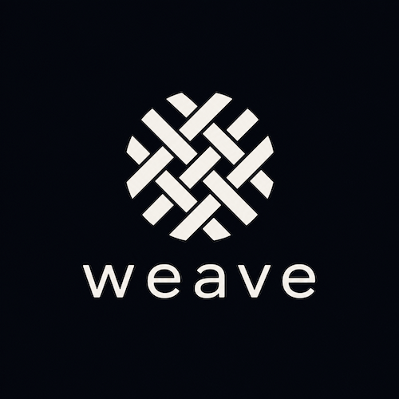

# weave

  

  

Weave is a terminal-based agent manager. It lets you:

- Create and manage agents backed by Claude or Codex
- Orchestrate agent pipelines with Weave's MCP
- Build custom actions and hooks
- Group agents into workflows with common behaviors
- Create schedules for your agents

If you're a Neovim or Emacs user, or just enjoy working from your terminal, weave is for you.

## Quickstart

1. Configure a Postgres database and set `connection.database_url` in your weave [configuration file](config.toml).
2. Install weave. See [installation](docs/install.md) for the full setup guide.
3. Press `prefix + g` to toggle the agent manager panel. Press `w` to create your first workflow, and then `a` to add your first agent.

## Why Weave

Keeping track of multiple agent sessions is difficult. Weave's persistent agent manager lets you browse, search, and interact with them more easily than juggling multiple terminal panels.

Weave is different from existing solutions like Conductor, Happy, or WorkMux in a few important ways:

### It is unopinionated.

Weave provides the primitives behind agentic workflows as resources that you manage directly: [workflows](docs/workflows.md), [agents](docs/agents.md), [actions](docs/actions.md), and [schedules](docs/schedules.md). It also provides an [MCP layer](docs/mcp.md) and a [CLI](docs/commands.md) so that you can have weave agents manage other agents. But it doesn't tell you how to use them: that's your call.

Weave is optimized for software development with [worktrees](https://git-scm.com/docs/git-worktree), but is equally capable of handling production support automations, or even Slack or email workflows. Let weave automate the parts of your job you dislike.

### It terminal (tmux) based.

Weave is a terminal tool, intended for power users. It does not aspire to be a remote coding environment or a standalone application, and meets you in the terminal.

## Documentation

### Concepts and guides

- [Installation](docs/install.md): the tmux plugin setup
- [How it works](docs/concepts.md): the state model, the store and server, the reconciler, and agents

### Terminology

- [workflows](docs/workflows.md): The shared templates for agents
- [agents](docs/agents.md): The core resource of weave
- [actions](docs/actions.md): Custom scripts that your agents can invoke
- [schedules](docs/schedules.md): Durable schedules for running your agents
- [MCP](docs/mcp.md): Lets agents spawn or manage other agents
- [Mail](docs/mail.md): How agents communicate with each other
- [CLI](docs/commands.md): The CLI tool and commands
